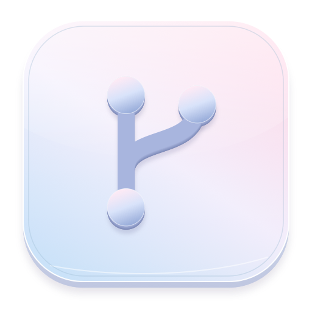
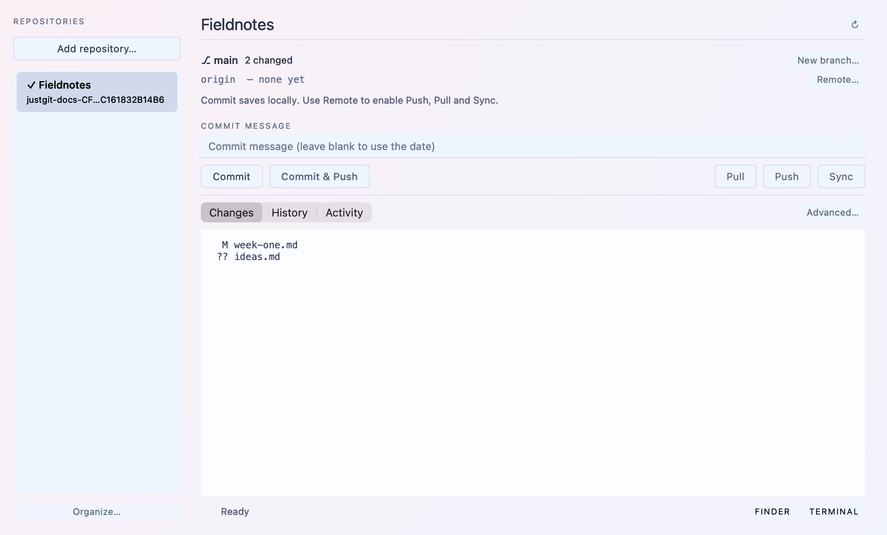

# JustGit

**Open a folder. Commit your work. Sync when ready.**

A compact Git app for macOS and Windows, with repository groups, commit history,
conflict recovery, and customizable light/dark themes.

[Download the latest release](https://github.com/jing1ei/justgit/releases/latest) ·
[Build and development guide](docs/DEVELOPMENT.md)

## Download packages

Choose the package for your computer from [GitHub Releases](https://github.com/jing1ei/justgit/releases/latest).

| Computer | Package |
| --- | --- |
| Mac with Apple silicon | `JustGit-1.0.2-macOS-arm64.dmg` |
| Mac with Intel | `JustGit-1.0.2-macOS-x64.dmg` |
| Windows x64 | `JustGit-1.0.2-Windows-x64.exe` |

On macOS, open the DMG and drag the app to Applications. On Windows, run the EXE installer.
Each release includes one source ZIP and `SHA256SUMS.txt`.

## Get started

1. Install Git. Open `JustGit.app` on Mac, or run the Windows EXE installer
   and open JustGit from the Start menu.
2. Choose **Add repository…** and select a local folder. For a new project,
   choose **Initialize repository**. Clone online repositories with Git first.
3. Set your Git name and email in **Settings**.
4. Review **Changes**, enter a message, and **Commit**. This saves all changes,
   including untracked files Git does not ignore. A blank message uses the date.
5. Configure **Remote** to enable Push, Pull, and Sync.

| Action | Result |
| --- | --- |
| Commit | Save a local snapshot. |
| Commit & Push | Save, then upload. |
| Push | Upload the current branch to `origin`. |
| Pull | Fetch and rebase; autostash tracked edits. |
| Sync | Commit → pull → push; stop on failure. |
| Refresh | Update repository status. |

Use the sidebar to switch repositories and **Organize…** to group or reorder them.
Commit drafts stay with each repository during the session. **History** shows
recent commits; **Activity** contains command results and recovery references.

Mac shortcuts: **⌘O** Open, **⌘R** Refresh, **⌘Return** Commit & Push.
Windows: **Ctrl+O**, **Ctrl+R**, **Ctrl+Enter**.
On Mac, click the menu-bar icon to show or hide the panel; right-click for Settings
and Quit. There is no Dock icon.

## Recovery

| Situation | Next step |
| --- | --- |
| Push/Pull unavailable | Set **Remote**; use **New branch** if HEAD is detached. |
| Identity or SSH failure | Check **Settings** and your Git host's public keys. |
| Conflicts | Edit files → **Resolve files** → **Continue**. **Abort** discards resolution edits. |
| Stash conflicts without an active operation | Resolve files and **Commit**; the stash is retained. |
| Pull would overwrite ignored files | Back up or move those files outside the repository, then retry. |
| Repository unavailable | Check the folder and permissions, then Refresh. |

**Advanced** contains Squash and force operations. Squash requires a clean tree
and complete history and creates a backup branch. Force Push previews remote-only
commits and offers a protected lease. Force Pull saves a backup and stashes local
files, including ignored files, before resetting. Recovery references appear in
Activity. Avoid concurrent Git changes during an operation.

## Appearance

**Automatic** follows the system light/dark setting. Choose a preset or open
**Settings → Edit style code** to customize colors and fonts. Use **Copy code**,
**Paste & Apply**, or **Copy for LLM**. Invalid code leaves the current appearance
unchanged; **Reset to automatic** restores the system theme.

## Compatibility

- **Mac:** macOS 11+, Intel and Apple silicon; Apple Git command-line tools required.
- **Windows:** Windows 10/11 x64; Git for Windows on PATH. Keep the portable folder
  together; no separate Python installation is needed for release downloads.

Mac builds are ad-hoc signed without notarization; Windows executables are unsigned.
Big Sur and Windows 10 desktop verification remains outstanding.

Releases include macOS, Windows, and source archives plus `SHA256SUMS.txt`.
Version tags trigger release builds; pushes to `main` run checks only.
See the [development guide](docs/DEVELOPMENT.md) for build and test instructions.

## Licence

All rights reserved. Use, modification, and redistribution require prior written
permission from the applicable copyright holder(s). See [LICENCE](LICENCE).
